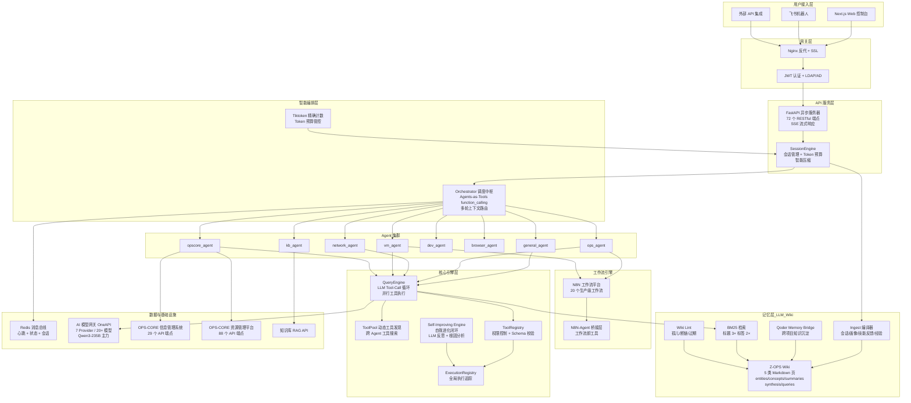

# Z-OPS (Intelligent Operation Claw) — 企业级 AI 运维智能体平台

> **版本**: v3.5 | **架构代号**: Hydra | **更新日期**: 2026-05

---

## 一、平台定位与核心价值

Z-OPS 是一套自主研发的 **企业级 AI 运维智能体平台**，采用业界领先的 **Multi-Agent 协作编排 + 自我进化闭环** 架构，将传统运维操作从人工逐条执行转变为自然语言驱动的智能化自动处理。

**核心价值主张**：

| 维度 | 传统运维 | Z-OPS 智能运维 |
|:---:|:---|:---|
| 交互方式 | 逐台 SSH / 多平台切换 / 手动查数据 | 自然语言一句话完成 |
| 响应速度 | 分钟级（找数据+分析+执行） | 秒级（AI 自动路由+并行查询+分析呈现） |
| 知识沉淀 | 依赖人记忆 / 文档分散 | RAG 知识库 + 自我进化经验积累 |
| 覆盖广度 | 受限于个人技能栈 | 8 专业 Agent × 30+ 运维技能全覆盖 |
| 进化能力 | 无 | Harness 自我进化 + 失败驱动自动改进 |

---

## 二、系统整体架构



---

## 三、分层架构详解

### 3.1 用户接入层

| 通道 | 技术栈 | 能力 |
|:---|:---|:---|
| Web 控制台 | Next.js 16 + React 19 + TailwindCSS + Framer Motion | 6 个核心页面（整合自 10）、SSE 流式对话、实时架构拓扑可视化 |
| 飞书机器人 | Webhook + Event Subscription | 群聊/私聊双模式，卡片消息推送 |
| API 集成 | RESTful + Bearer Token | 72 个端点，支持第三方系统调用 |

**前端功能矩阵**（6 个核心页面，整合自 10 页）：

| 页面 | 功能 | 亮点技术 |
|:---|:---|:---|
| `/` | AI 对话主界面 | SSE 流式 + Markdown 渲染 + Agent 路由标签 + Token 用量实时显示 |
| `/agents` | Agent 集群管理 | 双视图（架构拓扑图 + 详情卡片）、数据驱动动画、实时心跳 |
| `/observability` | 可观测性大盘 | 4-Tab（执行追踪 / Agent 性能 / Harness 进化 / 工具池）、Recharts 图表 |
| `/n8n` | 工作流编排 + 通知管理 | 分类视图、一键触发、执行历史、多通道通知 |
| `/admin` | 管理后台 | LLM 配置 + 通知配置 + 日志 + 用量统计（9 Tab 合并）|
| `/logs` | 运维日志 | 按会话分组、Agent 来源标注、时间线 |

### 3.2 智能编排层（核心差异化）

**Orchestrator 调度中枢**是 Z-OPS 的"大脑"，v3.5 完成路由架构的终极升级——**Agents-as-Tools function_calling**：

1. **LLM 原生 function_calling 路由** — 每个 Agent 定义为标准 OpenAI function tool，LLM 通过 `tool_calls[0].function.name` 直接选择路由目标
2. **tool_choice="required"** — 强制模型必须做出路由决策，100% 确定性，零模糊降级
3. **多轮上下文感知** — SessionEngine 加载历史 4 轮对话注入路由请求，支持追问/指代消解
4. **Agent 心跳监控** — 30s 超时检测，离线 Agent 自动降级提示
5. **Tiktoken 精确计数** — 基于 OpenAI tiktoken 库精确计算 token 消耗，动态调控上下文窗口
6. **零维护成本** — 新增 Agent 只需添加 tool 定义，无需维护关键词映射表

**路由架构演进**（参考 claude-code / hermes-agent 模式）：

```
v1.0: 正则关键词匹配              → 准确率 ~60%    维护成本: 高
v2.0: LLM JSON 文本分类              → 准确率 ~85%    维护成本: 中
v3.0: Jieba 关键词 + LLM 兜底       → 准确率 ~95%    维护成本: 高（关键词表）
v3.5: LLM 原生 function_calling      → 准确率 ~98%    维护成本: 零
```

### 3.3 Agent 集群（8 专业 Agent + 1 编排器）

| Agent | 职责域 | 核心技能 | 数据源 |
|:---|:---|:---|:---|
| **orchestrator** | 意图路由 + 任务派发 | Agents-as-Tools function_calling、心跳监控、上下文管理 | Redis |
| **general_agent** | 通用问答 + 文档生成 | RAG 增强问答、文档总结、最佳实践 | 知识库 |
| **ops_agent** | 巡检 + 监控 + 故障诊断 | SSH 采集、日志分析、批量执行、健康报告 | OPS-CORE + N8N |
| **network_agent** | 网络拓扑 + 连通性检测 | Ping 扫描、端口检测、路由追踪、配置审计 | OPS-CORE |
| **vm_agent** | VM 生命周期管理 | 开关机、快照、迁移、状态查询 | OPS-CORE + VMware + N8N |
| **dev_agent** | 自动化脚本生成与执行 | Shell/Python 生成、远程执行、Ansible | 本地 |
| **browser_agent** | Web 自动化操作 | Playwright 截图、表单填写、页面操作 | 浏览器引擎 |
| **opscore_agent** | 全平台数据智能查询 | 30+ Action、117 API 端点、Tool-Use 模式 | OPS-CORE 双平台 |
| **kb_agent** | RAG 知识增强 | 语义搜索、Query Rewriting、多路召回 | KB API |

### 3.4 核心引擎层（企业级基础设施）

#### QueryEngine — LLM 工具调用引擎（517 行）

参考业界最先进的 AI Agent 架构设计（如 Claude Code 的 Tool-Call Loop），实现：

- **Tool-Call 循环执行** — LLM 自主决定调用哪些工具，循环直到产出最终回答
- **并行工具执行** — 独立工具并发调用，显著降低端到端延迟
- **Token 预算管控** — 动态调整上下文长度，避免超限

#### ToolPool — 动态工具发现（383 行）

- **跨 Agent 工具搜索** — 任何 Agent 可发现并调用其他 Agent 注册的工具
- **延迟加载** — 工具按需加载，降低启动开销
- **Redis 持久化** — 工具注册信息跨进程可见

#### ExecutionRegistry — 全局执行追踪（250 行）

- **中央化记录** — 所有工具执行的入参、出参、耗时、状态全量记录
- **性能分析** — 支持按 Agent / 工具 / 时间维度的性能统计
- **可观测性** — 前端大盘实时展示执行追踪

#### Self-Improving Engine — 自我进化闭环（1157 行）

Z-OPS 最具前瞻性的模块，实现 Agent 系统的持续自我优化：

```
失败记录 → LLM 反思分析 → 根因识别 → 策略生成 → 技能改进 → A/B 验证 → 自动上线
```

- **LLM 驱动反思** — 对失败执行进行深度分析，提取改进方向
- **根因分析** — 区分数据问题、逻辑错误、超时等不同失败类型
- **经验衰减** — 旧经验随时间衰减，确保知识库新鲜度
- **跨技能迁移** — 一个技能的改进经验自动迁移到相似技能

### 3.5 记忆层 — LLM-Wiki 化知识编译（v3.5 新增）

受 Andrej Karpathy 的 LLM-Wiki 范式启发，Z-OPS 把原本散落在多份 JSON 的"记忆堆"升级为一个**由 LLM 在入库时编译好的结构化 Markdown 知识库**，实现 *ingest-time understanding* 替代 *retrieval-time understanding*。

**核心模块**（位于 `core/memory/`）：

| 模块 | 行数 | 作用 |
|:---|:---|:---|
| `wiki_store.py` | 339 | Markdown + YAML frontmatter 读写、幂等证据追加、双向链接扫描、index/log 维护 |
| `wiki_ingest.py` | 450 | 4 个真实数据源 → 5 类页面的编译器（规则式，可注入 LLM summarizer） |
| `wiki_query.py` | 210 | 轻量 BM25（标题 3× / 标签 2× / Evidence 0.5×），整页返回 |
| `wiki_lint.py` | 106 | 孤儿 / 断链 / 过期 / 重复 / 缺 frontmatter 健康检查 |
| `qoder_memory_bridge.py` | 169 | 把 Qoder 跨项目 memory 沉淀到 `wiki/concepts/` |
| `bootstrap_qoder_memory.py` | 304 | 首轮 29 条 Z-OPS 相关 Qoder memory 的导入种子 |

**三大操作**（对应 Karpathy 的 Ingest / Query / Lint）：

```
Ingest：会话结束 → 自动编译 → 合并到 entities/concepts/summaries/synthesis
Query ：用户问题 → BM25 命中 → 整页喂 LLM（小而精，可整库进 128K）
Lint  ：每日 → 标记孤儿/断链/过期 → 自动打 archived 标签
```

**五类页面**：

| 类型 | 目录 | 内容 | 数据源 |
|:---|:---|:---|:---|
| Entity | `wiki/entities/` | user / agent / skill / asset | cross_session_memory + user_profiles + skill_improvements + experiences |
| Concept | `wiki/concepts/` | SOP / 经验 / 故障模式 | session.topics ≥2 次 + Qoder memory |
| Summary | `wiki/summaries/` | 单次会话摘要 | cross_session_memory.sessions |
| Synthesis | `wiki/synthesis/` | 跨会话综合（如失败模式） | skill_improvements 聚合 |
| Query | `wiki/queries/` | 高价值问答归档（自增长） | 被采纳的 Q&A |

**行为契约（Karpathy 核心创新）**：

`wiki/AGENTS.md` + `wiki/SCHEMA.md` 是给 LLM 看的"行为合同"。
修改这两份 Markdown 即可调整摘要格式、频次阈值、页面模板、质量阈值——**无需改一行代码**。

**与 Self-Improving Engine 的协同**：

```
Self-Improving：LLM 反思失败 → 生成改进策略 → A/B 验证 → 上线
LLM-Wiki     ：上述改进经验 → 编译进 wiki/concepts/ → 下次同类问题直接命中
```

两者形成闭环：Self-Improving 负责"想通"，LLM-Wiki 负责"记住"。

### 3.6 工作流引擎层

集成 N8N 低代码工作流平台，实现复杂运维流程的可视化编排：

| 类别 | 工作流 | 触发方式 |
|:---|:---|:---|
| 巡检类 | daily_health_report / cluster_health_check / disk_space_check | 定时 + 手动 |
| 备份类 | backup_check / backup_restore | 定时 + Agent 触发 |
| 虚拟化 | vm_power / vm_snapshot / create_vm | Agent 触发 |
| AD 管理 | ad_user_create / ad_user_disable / ad_group_add | 审批触发 |
| 告警 | alert_receiver / auto_diagnosis / emergency_reboot | 事件驱动 |
| 通知 | notification / feishu_card / weekly_usage_report | 定时 + 事件 |
| 数据同步 | cmdb_sync / approval_request | 定时 |

**Agent-工作流桥接**：N8N 工作流注册为标准 ToolDef，Agent 可通过统一工具调用接口触发任何工作流。

---

## 四、数据流架构

### 4.1 请求处理全链路

```
用户输入
  ↓
Nginx SSL 终结 + 反代
  ↓
FastAPI (JWT 认证)
  ↓
SessionEngine (加载历史 + Token 压缩)
  ↓  ←── Wiki BM25 检索（注入相关 entities/concepts/synthesis 整页入上下文）
Redis Pub/Sub → Orchestrator
  ↓
LLM function_calling (tools=8个Agent, tool_choice=required)
  ↓
tool_calls[0].function.name → 目标 Agent
  ↓
QueryEngine (Tool-Call Loop)
  ↓
并行调用: LLM + OPS-CORE API + N8N + KB
  ↓
ExecutionRegistry 记录
  ↓
SSE 流式回复 → 用户
  ↓
会话结束 → cross_session_memory → Wiki Ingest 增量编译（后台触发）
```

### 4.2 多模型智能路由

```
OneAPI 统一网关 (https://aigw-noc.example.com/v1)
  ├── Qwen3-235B-A22B (主力推理)
  ├── Qwen3-30B-A3B / Qwen3-32B (快速响应)
  ├── DeepSeek-V3-0324 / DeepSeek-R1 (深度推理)
  ├── GPT-4.1 / GPT-4o (多模态)
  ├── Claude Sonnet 4 (代码生成)
  ├── GLM-4-Plus (中文优化)
  └── Ollama 本地模型 (离线场景)
```

---

## 五、安全架构

| 层面 | 机制 | 实现 |
|:---|:---|:---|
| 网络层 | HTTPS + SSL/TLS | Nginx SSL 终结，全链路加密 |
| 认证层 | JWT + LDAP/AD 双通道 | 企业域账号 SSO + 本地账号 |
| 授权层 | 管理员审批制 | 新用户需管理员授权 + 邮件通知 |
| 数据层 | 智能脱敏引擎 | 12+ 类敏感数据自动识别与掩码 |
| 工具层 | 权限策略 (allow/deny) | 每个 Agent 独立权限边界 |
| 审计层 | 全量操作日志 | 审计追踪 + 执行记录持久化 |

---

## 六、可观测性体系

Z-OPS 构建了完整的系统可观测性：

| 维度 | 数据源 | 可视化 |
|:---|:---|:---|
| 执行追踪 | ExecutionRegistry | 工具调用时间线、成功率、耗时分布 |
| Agent 性能 | Redis 统计 + 心跳 | 调用次数、响应时间、在线率 |
| 自我进化 | Harness 引擎 | 失败分析、改进历史、技能演进 |
| 工具池 | ToolPool Registry | 注册工具数、调用频次、跨 Agent 使用 |
| 系统资源 | /proc + psutil | CPU / 内存 / 磁盘实时监控 |
| Token 用量 | Tiktoken 精确计数 | 模型用量趋势、会话消耗分布 |

---

## 七、技术指标

| 指标 | 数值 |
|:---:|:---:|
| Python 后端代码 | **30,101 行** |
| TypeScript 前端代码 | **5,522 行** |
| 总代码量 | **37,683 行** |
| Python 模块文件 | 102 个 |
| 前端核心页面 | 6 个（整合自 10）+ 11 个组件 |
| Core 核心引擎 | 25 个模块 |
| API 端点 | 72 个 RESTful |
| Agent 专业体 | 9 个（8 专业 + 1 编排器） |
| 运维技能 | 30+ 个 |
| OPS-CORE API 对接 | 117 个端点（29 + 88） |
| N8N 工作流 | 20 个生产级 |
| LLM Provider | 7 家 / 20+ 模型 |
| 工作流 JSON | 1,829 行 |
| YAML 配置 | 231 行声明式 Agent 配置 |
| 路由准确率 | **~98%+**（function_calling 原生路由） |
| 部署运行时间 | 59 天+ 连续运行 |

---

## 八、技术创新亮点

### 8.1 Self-Improving 自我进化引擎

业界罕见的 Agent 系统自我进化能力，无需人工干预即可持续优化：

- 失败执行自动捕获 → LLM 深度反思 → 根因分类 → 策略生成 → A/B 验证 → 自动部署
- 跨技能迁移学习：一个 Agent 的改进经验自动应用到相似场景

### 8.2 数据驱动的架构可视化

Agent 集群页面的拓扑动画完全由真实 API 调用数据驱动：
- 无实际流量时静默无动画
- 有真实调用时，粒子沿连线流动，精确展示数据流向
- 8 秒后自动消散，避免视觉噪音

### 8.3 QueryEngine Tool-Call Loop

借鉴 Claude Code / Claw-Code 等顶尖 AI Agent 系统的核心设计：
- LLM 自主决策调用工具序列
- 支持并行独立工具调用
- Token 预算动态管控

### 8.4 Agents-as-Tools 原生路由（v3.5）

参考 claude-code / hermes-agent 架构，彻底消除关键词写死：
- 每个 Agent 定义为标准 OpenAI function tool（含能力描述 + 参数 Schema）
- `tool_choice="required"` 强制模型必须做路由决策
- 零关键词维护、零 JSON 解析 hack、所有用户路由完全一致

### 8.5 N8N 工作流即工具

突破性地将低代码工作流注册为 Agent 可调用的标准工具：
- Agent 可通过自然语言触发复杂工作流
- 工作流执行结果自动回传 Agent 进行后续分析

---

## 九、部署架构

```
生产环境: Ubuntu 22.04 LTS
  ├── Nginx (SSL + 反代)
  ├── Next.js 16 (前端, port 3000)
  ├── FastAPI (后端 API, port 7789)
  ├── Redis 6.0 (消息总线 + 状态存储)
  ├── Agent 进程集群 (24 进程)
  ├── N8N 工作流引擎
  └── OneAPI 模型网关 (https://aigw-noc.example.com)

域名: https://opscore-ai.example.com
```

---

## 十、演进路线

### 版本演进全景

| 版本 | 时间 | 里程碑 | 核心突破 | 状态 |
|:---|:---|:---|:---|:---:|
| **v0** | 2025.06-10 | Dify 工作流探索 | Dify 工作流验证 + 本地 DeepSeek 部署 + Agent 原型设计 | ✅ |
| **v1.0** | 2025.11 | 基础智能体上线 | 单 Agent + 自然语言对话 + OPS-CORE API 对接 | ✅ |
| v1.1 | 2025.12 | 数据查询增强 | 备份/快照/VCD 查询技能 + 多数据源路由 | ✅ |
| v1.2 | 2025.12 | 渠道扩展 | 飞书机器人接入 + Redis Pub/Sub 消息总线 | ✅ |
| **v2.0** | 2026.01 | 多 Agent 协作架构 | Orchestrator 编排 + 8 Agent 集群 + Skills 框架 | ✅ |
| v2.1 | 2026.01 | 知识增强 | RAG 知识库 + KB Agent + 多路召回 | ✅ |
| v2.2 | 2026.02 | Web 平台化 | Web 前端 + JWT/LDAP 认证 + 管理后台 | ✅ |
| v2.3 | 2026.02 | 对话智能升级 | 多轮上下文记忆 + 会话压缩 + 意图路由增强 | ✅ |
| v2.4 | 2026.02 | 安全合规 | 数据脱敏引擎 + API Keys 管理 + 审计日志 | ✅ |
| **v3.0** | 2026.03 | 核心引擎革命 | QueryEngine Tool-Call 循环 + ToolPool 动态发现 + ExecutionRegistry 全局追踪 + Self-Improving 自我进化 | ✅ |
| v3.1 | 2026.03 | 前端全栈重构 | Next.js 16 + AppShell 统一布局 + 可观测性大盘 + 实时 Agent 状态监控 | ✅ |
| v3.2 | 2026.03 | 工作流自动化 | N8N 引擎集成 (20 生产工作流) + Agent↔工作流桥接 + 邮件通知系统 | ✅ |
| v3.3 | 2026.04 | 架构可视化与治理 | Agent 拓扑连线图 + 数据驱动动画 + 多模型动态配置 + Tiktoken/Jieba 增强 | ✅ |
| v3.4 | 2026.04 | 权限与导航重构 | RBAC 前端权限隔离 + 页面架构整合 (10→6 入口) + 分组导航 + 路由级鉴权 | ✅ |
| **v3.5** | 2026.05 | 路由架构终极升级 | Agents-as-Tools function_calling 原生路由 + ToolPool 心跳续期 + 零维护成本 | ✅ |
| **v4.0** | 规划中 | 企业级平台化 | 审批流程引擎 + MCP 协议 + 移动端 + Agent Marketplace | 规划中 |

### 架构演进里程碑

```
v0(Dify) ───► v1.0 ─── v1.1 ─── v1.2 ───► v2.0 ─── v2.1 ─── v2.2 ─── v2.3 ─── v2.4 ───► v3.0 ─── v3.1 ─── v3.2 ─── v3.3 ─── v3.4 ─── v3.5 ───► v4.0
│                │                                │                                              │                                                        │
Dify探索            单Agent对话                          多Agent协作                                     核心引擎革命                                              企业级平台化
2025.06            2025.11                           编排+技能+知识                                  工具链+自进化+function_calling                             MCP+审批+移动端
```
